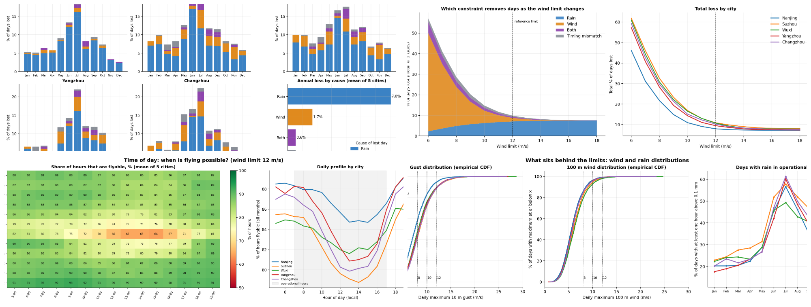
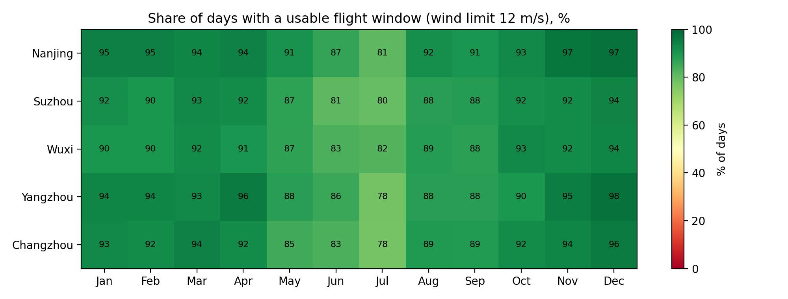
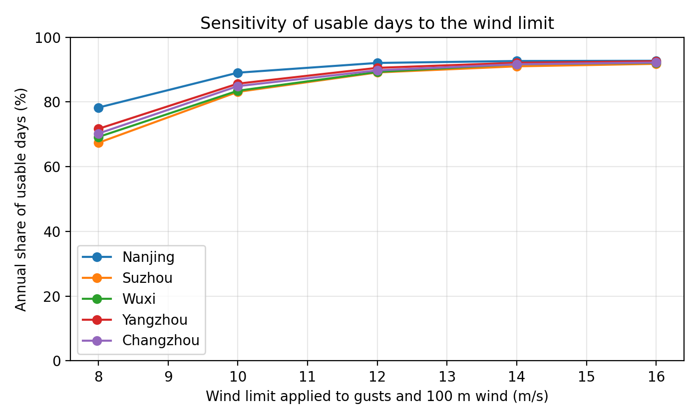
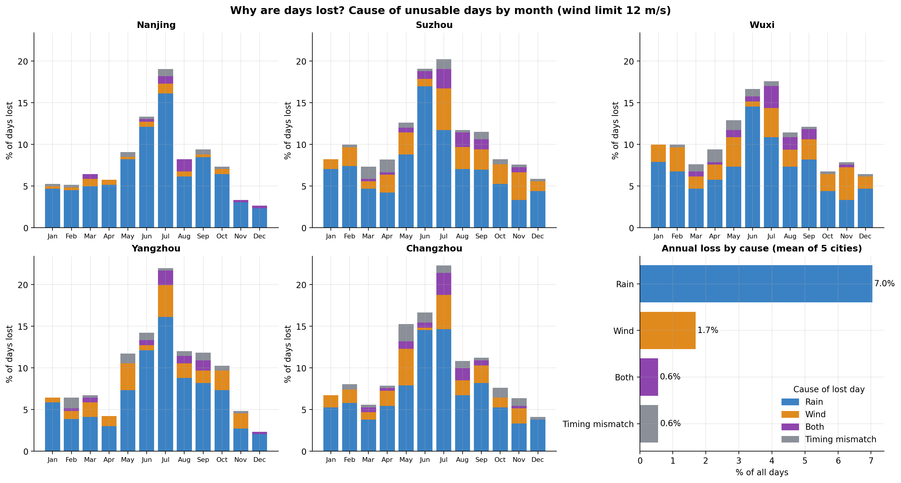
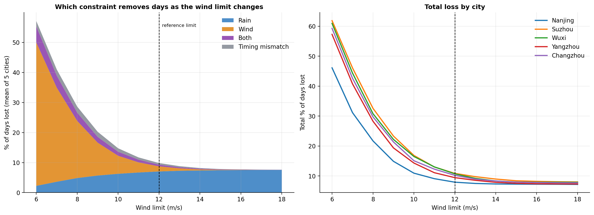
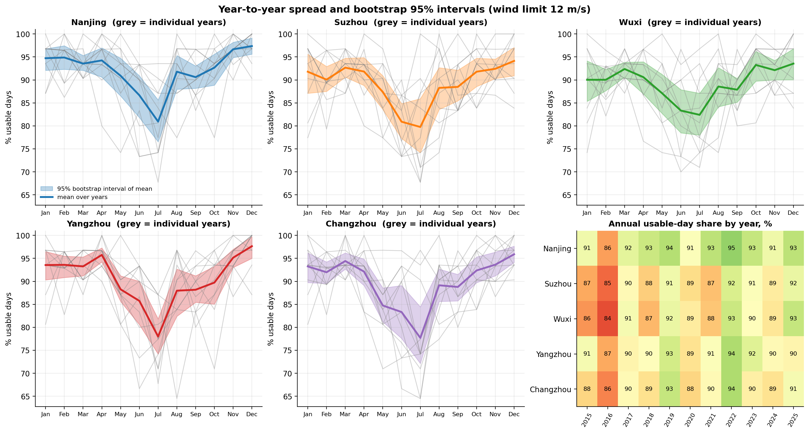
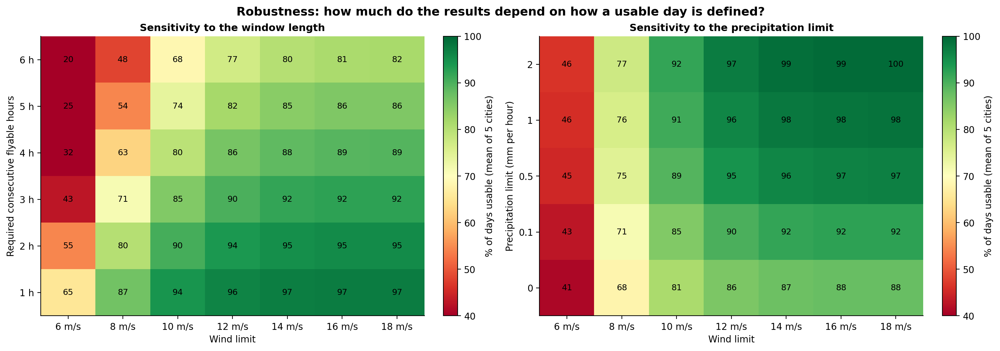
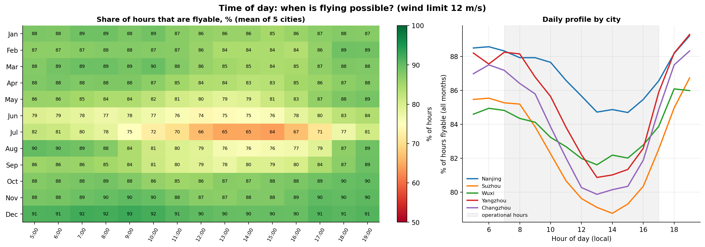
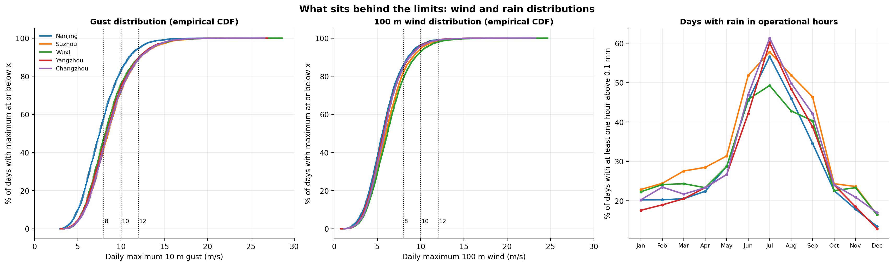

# FlightWindow: A Weather-Aware AI Planner for Scarce Low-Altitude Test Airspace in Jiangsu

<p align="center">
  
</p>

**Proposal for the 2026 JHMUA Excellence Cup: Bridging Minds for Regional Innovation**

**Track:** Technology-Driven Advancements (with links to Economic Growth & Innovation and Cross-Regional Collaboration)

**Region:** Jiangsu, scalable to Hong Kong and Macao

**Author:** Umair M M, BSc (2nd year student), Aeronautical Engineering, Nanjing University of Aeronautics and Astronautics (NUAA)

**Supervisor:** Bo CUI, College of Economics and Management, Nanjing University of Aeronautics and Astronautics (NUAA)

---

## Executive summary

Jiangsu's five leading low-altitude cities (Suzhou, Wuxi, Nanjing, Yangzhou and Changzhou) have three-year plans that together aim above 180 billion yuan in output [1], yet firms in Nanjing report that airspace for test flights and demonstrations is limited [2]. When test airspace and test days are scarce, every day lost to weather delays certification and product launches. This proposal measures that loss from public data and presents FlightWindow, a decision-support planner that forecasts flyable windows and schedules test campaigns around them.

Using 11 years of hourly ERA5-based weather (2015–2025, 4,018 days) for five Jiangsu cities, we find that weather is a modest annual constraint for aircraft that tolerate 12 m/s winds: 89–92% of days offer a 3-hour dry, low-wind window, and rain rather than wind accounts for about 72% of the days lost. It is a heavy constraint in two cases: light aircraft (only 67–78% of days usable at an 8 m/s limit) and the rainy season (in July only 78–82% of days are usable at 12 m/s on average, and only 64.5–71.0% in the worst of the 11 Julys). Bad days cluster for a day or two but not much longer. For a campaign needing 10 usable test days, weather adds on average 0.9–1.3 calendar days at 12 m/s, computed from every historical start date; the figure is 2.1–2.6 days for a start in June or July and 0.3–0.8 days for a start in November or December. At 10 m/s and 8 m/s the formula-based averages are 1.2–2.0 and 2.8–4.8 days. These baselines show where a forecast-aware planner has the most to recover. Because every input is public data and the pipeline is site-agnostic, the approach transfers to Hong Kong's low-altitude regulatory sandbox [3].

---

## 1. Problem and regional context

### 1.1 Jiangsu's low-altitude push

Jiangsu's provincial AI+ action plan sets 2030 targets of a 90 percent adoption rate for new-generation smart terminals and an AI industry above 1 trillion yuan [4]. With this background, five cities have written low-altitude plans [1]; Pukou (Nanjing) and Wujiang (Suzhou) were named provincial low-altitude trial districts [5]. Hardware is also reaching the test stage: a Wuxi company's 8-tonne cargo eVTOL came off the production line in July 2026, with test flights and airworthiness certification next [6].

### 1.2 The bottleneck: scarce test airspace

Nanjing firms report that limited airspace for test flights and demonstrations constrains R&D and industrialisation [2]. Rules also differ from city to city, which is why Yangtze River Delta players call for borderless airspace and mutual recognition of standards [7]. Under the national regulations on unmanned aircraft flight, in force since 1 January 2024, an operator who needs approval must apply before 12:00 on the day before the flight; the air traffic authority decides before 21:00 that day [8]. Procedures for manned aircraft such as eVTOLs, for temporary airspace and for test-zone allocation differ from these rules. This study did not verify their lead times. The planner therefore treats booking lead time as a configurable parameter and does not assume a value.

### 1.3 Why weather still matters with a one-day filing deadline

The author's reasoning, not a documented finding, is that weather matters for test programmes in three ways. First, a programme needs several usable days, and crews, aircraft and range time are usually committed ahead (an assumption to validate with operators). Second, when airspace is scarce, a day lost to weather is hard to recover. Third, the day-before filing decision is only as good as the forecast available at 12:00. Three hypotheses structure the work:

- **H1 (tested in this proposal).** Weather removes a material share of potential test days, depending on aircraft wind limits and season.
- **H2 (next phase).** Forecasts at 1 to 7 day leads carry enough skill beyond climatology to improve scheduling decisions.
- **H3 (next phase).** A probability-aware planner reduces expected campaign delay and wasted resources compared with weather-blind scheduling.

### 1.4 Who is affected

Those affected are test operators and aircraft manufacturers (such as the Wuxi eVTOL developer above); test-zone and airspace managers who allocate limited windows; and, as the sector matures, inspection, logistics, agriculture and sightseeing operators who face the same weather-window problem.

---

## 2. Novelty and gap

| Existing capability | What it does | What the reviewed public material does not describe |
|---|---|---|
| Provincial and municipal low-altitude maps and service platforms [9] | Publish suitable airspace and support flight services | Probabilistic, weather-aware planning of scarce test days |
| General weather and drone apps | Show deterministic forecasts | Aircraft-class limits, calibrated multi-day probabilities, scheduling across competing requests |
| Academic weather-aware UAV planning | Often optimises the path of a single flight | Allocation of limited test days across many requests and campaigns |

**Contribution.** (i) A quantified, site-level flyability climatology for Jiangsu's five low-altitude cities, with sensitivity to aircraft wind limits, a split of lost days into rain and wind causes, bootstrap uncertainty, and campaign delays computed from every historical start date (Sections 4 and 5); (ii) a design for a calibrated 1 to 7 day flyable-window forecaster; (iii) a campaign and slot planner with a standby policy; (iv) an open, reproducible, site-agnostic pipeline. The novelty claim is limited to the public materials reviewed by the author.

---

## 3. Proposed solution

### 3.1 Pipeline

| Stage | Input | Method | Output |
|---|---|---|---|
| 1. Data | Reanalysis history, archived forecasts, station observations, site definitions | Automated download and cleaning | Hourly weather table per site |
| 2. Flyability | Aircraft-class limits (gust, sustained wind, precipitation) | Rule-based labelling with a limit sweep | Hourly flyable flag, daily usable-window flag |
| 3. Forecaster | Forecast variables at lead 1 to 7 days, seasonal climatology | Gradient-boosted trees with probability calibration | Calibrated probability of a usable window per site and day |
| 4. Planner | Campaign and slot requests, probabilities, filing deadline | Integer programming over a short horizon, greedy fallback | File, standby or avoid recommendations |

### 3.2 Definitions

For an aircraft class, an hour is flyable if the 10 m gust and the 100 m sustained wind are at or below the wind limit and precipitation is at or below 0.1 mm per hour. A day is usable if it contains at least 3 consecutive flyable hours between 07:00 and 17:00 local time. All of these are configurable parameters. The wind limit is swept rather than fixed because real limits depend on the specific aircraft and its approval conditions. In every month the least flyable hour of the day falls inside the 07:00–17:00 window (Appendix C, Figure C1), so the window is a conservative choice, not a favourable one. Window length and rain limit are tested in Section 4.4.

### 3.3 Forecaster (design)

The target is the daily usable-window flag. Features are forecast wind, gust and precipitation for the target day at each lead time, the climatological usable rate for that date, lead time and season. A gradient-boosted tree model [10] is trained with time-ordered splits to avoid leakage and calibrated with Platt or isotonic scaling [11]. Baselines are climatology and thresholding of the raw deterministic forecast. Evaluation uses the Brier score, reliability diagrams [12] and AUC, reported per lead time. Machine learning earns its place only if it beats these baselines; the proposal commits to reporting this comparison honestly.

### 3.4 Planner (design)

The planner works at two decision layers. **Layer A, campaign planning (days to weeks ahead):** given a campaign that needs K usable days inside a date range, and several competing requests for scarce windows, choose start dates and standby days to maximise expected completed test days. This is a small integer program, with a greedy heuristic as fallback. **Layer B, the day-before decision:** use the latest forecast to decide whether to file for day D before the 12:00 deadline on D-1 [8]. Baselines for the backtest are first-come weather-blind booking, season-blind scheduling, climatology-only scheduling, and an oracle with perfect foresight as an upper bound.

### 3.5 Safety and governance

FlightWindow is decision support only. It does not authorise flights, replace airworthiness or airspace approvals, or override operators and authorities. It uses no personal data, and every output carries its uncertainty.

---

## 4. Data, method and preliminary results

### 4.1 Data and method

Hourly weather for 2015–2025 was obtained from the ERA5 reanalysis [13] through the Open-Meteo historical API [14] for five points representing Suzhou, Wuxi, Nanjing (Pukou area), Yangzhou and Changzhou. The coordinates are approximate city locations, not surveyed test sites. Variables are 10 m wind gust, 100 m wind speed and hourly precipitation. A single wind limit is applied to both the gust and the 100 m wind, which is deliberately conservative. The limit is swept from 8 to 16 m/s in the main tables and from 6 to 18 m/s in Figures 4 and 6, with 12 m/s as the reference. All 4,018 days were analysed for every city. Besides the climatology in Tables 1 and 2, the proposal reports six further checks on the same data: attribution of lost days to rain or wind and bootstrap intervals that resample the 11 years [15] (Section 4.2); sensitivity to the definition of a usable day (Section 4.4); clustering of bad days and campaign delays computed from every historical start date (Section 5.2); and hourly profiles and distributions (Appendix C). The full code, tables and figures are in the submission package (Appendix B) and can be regenerated with the two scripts listed there.

### 4.2 Results

**Table 1.** Share of days with a usable flight window by month, % (wind limit 12 m/s, precipitation at most 0.1 mm/h, at least 3 consecutive flyable hours between 07:00 and 17:00).

| City | Jan | Feb | Mar | Apr | May | Jun | Jul | Aug | Sep | Oct | Nov | Dec |
|---|---:|---:|---:|---:|---:|---:|---:|---:|---:|---:|---:|---:|
| Nanjing | 94.7 | 94.9 | 93.5 | 94.2 | 90.9 | 86.7 | 80.9 | 91.8 | 90.6 | 92.7 | 96.7 | 97.4 |
| Suzhou | 91.8 | 90.0 | 92.7 | 91.8 | 87.4 | 80.9 | 79.8 | 88.3 | 88.5 | 91.8 | 92.4 | 94.1 |
| Wuxi | 90.0 | 90.0 | 92.4 | 90.6 | 87.1 | 83.3 | 82.4 | 88.6 | 87.9 | 93.3 | 92.1 | 93.5 |
| Yangzhou | 93.5 | 93.6 | 93.3 | 95.8 | 88.3 | 85.8 | 78.0 | 88.0 | 88.2 | 89.7 | 95.2 | 97.7 |
| Changzhou | 93.3 | 92.0 | 94.4 | 92.1 | 84.8 | 83.3 | 77.7 | 89.1 | 88.8 | 92.4 | 93.6 | 95.9 |



**Figure 1.** Share of days with a usable flight window by city and month at a 12 m/s wind limit. July is the weakest month in every city.

**Table 2.** Annual share of usable days by wind limit, %.

| City | 8 m/s | 10 m/s | 12 m/s | 14 m/s | 16 m/s |
|---|---:|---:|---:|---:|---:|
| Nanjing | 78.3 | 89.0 | 92.1 | 92.7 | 92.7 |
| Suzhou | 67.4 | 83.1 | 89.1 | 91.0 | 91.8 |
| Wuxi | 69.2 | 83.5 | 89.3 | 91.7 | 92.1 |
| Yangzhou | 71.7 | 85.7 | 90.5 | 92.1 | 92.6 |
| Changzhou | 70.3 | 84.9 | 89.8 | 91.7 | 92.2 |



**Figure 2.** Sensitivity of the annual usable-day share to the wind limit applied to gusts and 100 m wind.

#### Why days are lost

A day can fail because of rain, because of wind, because of both, or because the dry hours and the calm hours do not coincide. Figure 3 attributes every unusable day to one of these four causes at the 12 m/s reference limit (definitions in the caption). Averaged over the five cities, 9.8% of days are unusable: 7.0% of all days are lost to rain only, 1.7% to wind only, 0.6% to both and 0.6% to timing mismatch. Rain alone therefore accounts for about 72% of lost days (67–72% in four cities and 87% in Nanjing, where wind-only losses are smallest). Figure 4 repeats the split as the wind limit changes. Wind is the larger cause below 10 m/s: at 8 m/s the average loss is 28.6% of days, of which 19.0% is wind only and 4.9% rain only. The two causes are about equal at 10 m/s (6.0% wind only, 6.3% rain only). From 10 m/s upward rain is the larger cause, and from 14 to 18 m/s the average loss falls by only 0.6 percentage points, to a floor of about 7.6% that is almost entirely rain.



**Figure 3.** Cause of unusable days by city and month at a 12 m/s wind limit (lower right: annual loss by cause, mean of the five cities). A day is attributed to rain if it would have been usable under the wind rule alone, to wind if it would have been usable under the rain rule alone, to both if neither rule alone gives a usable window, and to timing mismatch if each rule alone is satisfied but not within the same consecutive hours.



**Figure 4.** Cause of unusable days versus wind limit.



**Figure 5.** Monthly usable-day share for each year (grey lines), mean over years (coloured line) and 95% bootstrap interval of the mean (band), at a 12 m/s wind limit. The lower right panel gives the annual usable-day share by year and city.

#### Six findings from the tables and figures

1. **Annual loss is modest for aircraft with a 12 m/s limit.** 89.1–92.1% of days are usable, so a weather-blind booking loses 7.9–10.9% of days (Table 2). The average hides year-to-year variation: individual years range from about 84% to 95% usable (Figure 5). The word modest holds for windows of up to about 3 to 4 hours (loss 10–14%) and not for a 6-hour window (loss 23%; Section 4.4).

2. **Light aircraft are far more exposed.** Usable days fall to 83.1–89.0% at 10 m/s and to 67.4–78.3% at 8 m/s, which means 22–33% of days are lost at 8 m/s. At 8 m/s the loss is mainly wind: 19.0 of the 28.6% average loss is wind only (Figure 4). Gusts are the binding variable. At a 10 m/s limit the daily maximum gust is above the limit on roughly one day in six in Nanjing and one in four elsewhere, against fewer than one day in ten for the 100 m wind (Figure C2).

3. **Rain, not wind, limits stronger aircraft.** Usable days plateau at 91.8–92.7% by 16 m/s. Figure 3 confirms the cause: at 12 m/s rain only removes 7.0% of days against 1.7% for wind only, and from 10 m/s upward rain is the larger cause at every limit (Figure 4). The rain limit of 0.1 mm/h is strict, though: relaxing it to 1 mm/h cuts the average loss at 12 m/s from 9.8% to 3.9% (Figure 6).

4. **The rainy season is the problem period.** July is the weakest month in every city (77.7–82.4% usable) and June is second-weakest (80.9–86.7%), while December is the best everywhere (93.5–97.7%). The June and July intervals overlap in every city, so the data do not separate the two months, but December's interval lies entirely above July's (Figure 5). Rain only is the largest cause in July in all five cities, with wind-related losses adding a quarter to a third of July losses in four of them (Figure 3). This fits the plum-rain period of the lower Yangtze, but the data show when rain peaks, not why, so the link remains the author's expectation.

5. **Sites differ most for light aircraft.** Nanjing is best at every limit. Its lead over Suzhou is 3.0 points at 12 m/s but 10.9 points at 8 m/s. The annual lead holds in all 11 years, and Nanjing has the highest or tied-highest annual share in 10 of them (Figure 5, rounded values), although the monthly intervals overlap. The difference appears to come from gusts: Nanjing's gust distribution lies to the left of the other four cities, while their 100 m wind distributions nearly coincide (Figure C2). Because ERA5 cells are about 25 km wide, site-level wind measurements are needed before any site comparison is relied on.

6. **Flyability dips in the afternoon, most in summer.** In every month the least flyable hour falls between 11:00 and 16:00. In July about 78–80% of hours are flyable at 07:00–08:00 against 64–67% at 13:00–16:00 (Figure C1). A scheduler that can choose the time of day, not only the day, may recover some July losses. This is a hypothesis for the planner phase, not a result.

### 4.3 What the results mean for the hypotheses

H1 is partly supported. Weather is a modest annual constraint for large or wind-tolerant aircraft in the dry season, so a planner would add little there. It is a heavy constraint for light aircraft, in June and July, and for long campaigns. The proposal is therefore aimed at those cases rather than claiming a universal benefit. The added checks sharpen this in three ways. First, the loss for aircraft above about 10 m/s is mostly rain, so rain timing is the forecast variable that matters most for them, while gusts matter most for light aircraft (Figures 3 and 4); the forecaster will therefore be evaluated separately for rain and for gusts. Second, the averages hide large year-to-year swings (Figure 5), so the planner must be judged on bad years as well as on the mean. Third, the word modest depends on the window a test needs: it holds up to about 4 hours and fails for a 6-hour window (Section 4.4). These figures are climatological baselines for weather-blind scheduling, not measured booking losses. H2 and H3 remain to be tested.

### 4.4 Feasibility and risks

The work needs just a laptop, some open Python tools (pandas, scikit-learn or LightGBM, an open integer-programming solver) and free public data. The data and flexibility stages of the pipeline (Section 3.1) and the checks reported in this proposal are already complete and reproducible. The author has 4 years of machine-learning experience and an aeronautical engineering background.

**Does the definition of a usable day drive the result?** The reference definition (at least 3 consecutive flyable hours, at most 0.1 mm/h of rain) is a modelling choice, so Figure 6 varies it. At 12 m/s the mean usable share falls from 96.4% with a 1-hour window to 77.0% with a 6-hour window, and it rises from 85.8% when no rain is tolerated to 97.2% at 2 mm/h. The pattern is stable: under every window length and rain limit tested, the usable share rises steeply with the wind limit up to about 12 m/s and flattens beyond 14 m/s. The level is not stable. A 3-hour window at 8 m/s loses 28.6% of days, and a 6-hour window at 12 m/s loses 23.0%, so a test that needs a long window faces a real weather problem even with a wind-tolerant aircraft. Figure 6 tests annual averages only; the seasonal pattern was not repeated under the alternative definitions.



**Figure 6.** Sensitivity of the annual usable-day share (mean of the five cities) to the required window length (left, precipitation limit 0.1 mm/h) and to the precipitation limit (right, 3-hour window), for wind limits of 6 to 18 m/s.

| Risk | Effect | Mitigation |
|---|---|---|
| Demand data for test slots is not public | Planner cannot be validated on real requests | Simulate request streams with documented assumptions, run sensitivity analysis, state the limitation, seek an operator pilot later |
| Aircraft limits differ from assumed limits | Usable-day shares shift | Limit sweep (Table 2), per-aircraft configuration |
| Definition of a usable day is a modelling choice | Levels shift: at 12 m/s the usable share ranges from 77% (6 h window) to 96% (1 h window) | Window length and rain limit are inputs; sweeps in Figure 6; seasonal pattern to be re-tested under other definitions |
| Only 11 years of data | Averages hide bad years; July intervals are 8 to 12 points wide | Report bootstrap intervals and worst-year values (Figure 5); judge the planner on bad years as well as the mean |
| Forecast archives are short | Little training data at long leads | Rolling-origin evaluation, report uncertainty, fall back to climatology where skill is not shown |
| Coarse reanalysis grid and approximate sites | Local winds and site differences are not captured | Station bias checks, conservative limits, real test-site coordinates in the next phase |
| Approval rules and lead times change | Filing-deadline parameter becomes outdated | Lead time is an input parameter, not hard-coded |

---

## 5. Projected impact

### 5.1 Metrics

The planner will be judged on wasted days per campaign, extra calendar days to complete a campaign, completed test hours per booked day and fairness across requests, each compared with the baselines in Section 3.4.

### 5.2 What weather costs, measured

Table 3 below uses a formula that treats days as independent, so that assumption is tested first. Figure 7 shows that bad days do cluster, but only briefly. Averaged over the five cities, 9.8% of days are unusable at 12 m/s but 23.5% are unusable when the previous day was, which is 2.4 times as often. The autocorrelation of the daily usable flag is 0.12–0.18 at a one-day lag, 0.04–0.07 at two days and 0.00–0.04 at three days, and then stays small; the few higher values at longer lags may reflect the seasonal cycle, which was not removed. Spells of unusable days have a mean length of 1.31 days, and the longest lasts 6 days. About 6–8% of spells last three days or more, against about 1% if days were independent. Clustering therefore lengthens spells without changing the long-run share of lost days, so the mean delay should stay close to the formula and the spread should be wider.


**Figure 7.** Persistence of unusable days at a 12 m/s wind limit: probability of an unusable day, with and without an unusable day before it (left); distribution of spell lengths compared with independent days (centre); autocorrelation of the daily usable flag, with the 95% band expected if days were independent (right).

Table 3 converts the measured usable-day shares into two quantities: days lost per 20 booked days under weather-blind booking, and the extra calendar days a 10-usable-day test campaign needs on average. The delay is computed as \(10 \times (1/p - 1)\), where \(p\) is the usable share, and assumes days are independent. Figure 7 shows the assumption is not exact, and Table 4 compares the formula with delays computed from the historical record.

**Table 3.** Measured weather cost for selected scenarios (computed from Tables 1 and 2).

| Scenario (wind limit, site or month) | Usable days, % | Weather-blind loss \(w\), % | Days lost per 20 booked | Extra calendar days for a 10-usable-day campaign |
|---|---:|---:|---:|---:|
| 12 m/s, best site (Nanjing) | 92.1 | 7.9 | 1.6 | 0.9 |
| 12 m/s, lowest site (Suzhou) | 89.1 | 10.9 | 2.2 | 1.2 |
| 12 m/s, worst month (July, Changzhou) | 77.7 | 22.3 | 4.5 | 2.9 |
| 10 m/s, lowest site (Suzhou) | 83.1 | 16.9 | 3.4 | 2.0 |
| 8 m/s, best site (Nanjing) | 78.3 | 21.7 | 4.3 | 2.8 |
| 8 m/s, lowest site (Suzhou) | 67.4 | 32.6 | 6.5 | 4.8 |

These values are the ceiling on what scheduling could recover, not a forecast of what it will recover. The recoverable share depends on forecast skill at the planning horizon, which the forecaster step will measure. As an example of scale, each 10% of the avoidable delay captured for 8 m/s aircraft at the lowest site is about 0.5 calendar days saved per 10-day campaign. Even without forecasts, season-aware scheduling is a free first gain: moving a campaign from July to December raises the usable share from about 78–82% to 93.5–97.7% in these cities (Table 1).

**Empirical check.** Figure 8 computes the extra calendar days for a 10-usable-day campaign from every historical start date at 12 m/s, and Table 4 compares the results with the formula. The empirical mean is 0.9–1.3 days and is within 0.06 days of the formula in every city, so the averages in Table 3 stand at 12 m/s. The spread is wide: the 90th percentile is 2 days in Nanjing and 3 days elsewhere, about twice the mean. The start month matters most. A campaign started in June or July loses 2.1–2.6 days on average, with a median of 2 days, and the middle half of June and July starts lose 1 to 4 days (Figure 8, left). A start in November or December loses 0.3–0.8 days, with a median of 0 or 1 day. Delay grows roughly in proportion to campaign length (Figure 8, right): averaged over the five cities, a 20-usable-day campaign loses about 2.3 extra days over all start dates and about 4.6 days if it starts in June or July.


**Figure 8.** Extra calendar days needed to complete a 10-usable-day campaign at a 12 m/s wind limit, computed from every historical start date, by start month (left); compared with the independence formula (centre); and as a function of campaign length (right).

**Table 4.** Extra calendar days to complete a 10-usable-day campaign at a 12 m/s wind limit: independence formula against delays computed from every historical start date.

| City | Formula (independent days) | Empirical mean, starts | Empirical all 90th percentile | Mean, start in Jun–Jul | Mean, start in Nov–Dec |
|---|---:|---:|---:|---:|---:|
| Nanjing | 0.9 | 0.9 | 2 | 2.1 | 0.3 |
| Suzhou | 1.2 | 1.3 | 3 | 2.5 | 0.8 |
| Wuxi | 1.2 | 1.2 | 3 | 2.1 | 0.8 |
| Yangzhou | 1.0 | 1.1 | 3 | 2.4 | 0.4 |
| Changzhou | 1.1 | 1.2 | 3 | 2.6 | 0.6 |

Season-aware scheduling alone therefore saves 1.3 to 2.0 calendar days per 10-day campaign between a June–July start and a November–December start, before any forecast is used. The empirical values were computed at 12 m/s only; the other rows of Table 3 remain formula-based.

### 5.3 Regional value

When airspace is the scarce resource, each recovered day shortens the time to a completed test campaign and avoids repeated applications. Recovering test days therefore supports the cities' low-altitude plans [1] without claiming credit for their targets. Fewer aborted sorties also mean less wasted energy and travel. In addition, avoiding launches in marginal weather may improve safety. Inspection, logistics, agriculture and sightseeing flights face the same weather-window problem, so the framework is a candidate for extension; this is future work, not a claim of this proposal.

---

## 6. Cross-regional scalability

Hong Kong operates a low-altitude regulatory sandbox that allows test flights of non-traditional aircraft, including eVTOLs and drones over 150 kg [3]. FlightWindow separates site, aircraft class and booking rules from its algorithms, so adapting it to Hong Kong or Macao needs only new coordinates, aircraft limits and local rules. The same design is relevant to the Yangtze River Delta call for borderless airspace [7]: a common, transparent window-probability layer can sit beside differing city rules. This is a design property of the proposal; no partnership with any Hong Kong or Macao body has been secured.

---

## 7. Implementation roadmap and team

| Phase | Deliverable |
|---|---|
| 0. Feasibility study | Flyability climatology for five cities with uncertainty, cause split, persistence and campaign-delay checks; reproducible code |
| 1. Forecaster | Calibrated 1 to 7 day model with lead-time evaluation; forecast skill reported separately for rain and for gusts |
| 2. Planner | Optimiser and backtest against baselines; real test-site coordinates |
| 3. Prototype | Weekly recommendation dashboard |
| 4. Pilot and extension | Operator pilot (not yet secured), open release, Hong Kong and Macao adaptation |

---

## 8. Limitations and ethics

First, test-slot demand is simulated and wind limits are assumptions. Second, the reanalysis grid is coarse, site coordinates are approximate and forecast archives are short. Third, the results are climatological baselines, so the benefit of the planner is not yet measured. Fourth, booking lead times for manned aircraft, temporary airspace and test zones were not verified. Fifth, only 11 years of data are available, so monthly intervals are wide (Figure 5). Sixth, the sensitivity checks in Figure 6 cover annual averages only. Seventh, reanalysis gusts and rain are modelled values on a coarse grid, and the link between the June–July losses and the plum-rain period is an expectation, not a tested result. The novelty statement is limited to the public materials reviewed. The tool is advisory, processes no personal data and does not replace regulatory approval.

---

## 9. How this proposal meets the judging criteria

| Criterion | Where addressed |
|---|---|
| Innovation and originality | Section 2: weather-aware, probabilistic planning of scarce test days |
| Feasibility and practicality | Sections 3 and 4: public data, completed preliminary analysis with uncertainty and robustness checks, reproducible code |
| Projected impact | Sections 5 and 6: measured weather cost with empirical campaign delays, ceiling on recoverable days, transfer to Hong Kong |
| Teamwork and synergy | Section 7: supervisor guidance and planned advisors |
| Presentation quality | Executive summary, tables and figures |

---

## 10. Conclusion

Jiangsu is building a low-altitude industry faster than it can open test airspace. Public data show that weather is a modest annual constraint for wind-tolerant aircraft, where rain causes most of the lost days. It is a heavy constraint for light aircraft, where wind is the main cause, and in the June–July rains, when a 10-day campaign loses 2.1–2.6 extra days on average and the worst of the 11 July left only 64.5–71.0% of days usable. A forecast-aware planner has the most to recover in these cases. FlightWindow offers a transparent, reproducible route from these baselines to a tested planner, a pilot with Jiangsu operators and transfer to Hong Kong and Macao.

---

## References

1. Changzhou Municipal People's Government. *Jiangsu leads low-altitude economy growth with 324 approved flight routes.* https://www.changzhou.gov.cn/ns_news/436174055712018 (accessed 30 October 2026).
2. Jiangsu Economic Daily, 4 June 2026, on the Nanjing low-altitude economy. https://doss.xhby.net/zpaper/jsjjb/pc/att/202606/04/9d2aedc4-482c-4ee2-85e0-bbf40a4aef4f.pdf
3. Hong Kong Transport and Logistics Bureau. *Eligibility for non-traditional aircraft applications (low-altitude regulatory sandbox).* https://www.tlb.gov.hk/sc/highlights/transport/非传统航空器申请资格_SC.pdf
4. China Daily regional edition, 16 January 2026, on Jiangsu's AI+ action plan. https://regional.chinadaily.com.cn/wic/2026-01/16/c_1156013.htm
5. Jiangsu Provincial Government, 8 September 2024, future-industry pilot list (Pukou and Wujiang low-altitude trial districts). https://en.jiangsu.gov.cn/art/2024/9/8/art_54122_11349821.html
6. Caijing, 21 October 2026, article on eVTOL commercialisation. http://stock.caijing.com.cn/20261021/5188884.shtml
7. The Paper (1 January 2024), Article 26; text reproduced at https://www.ithome.com/0/765/719.htm
8. National regulations on unmanned aircraft flight, in force 1 January 2024.
9. Yangzi Evening News, 12 January 2026, on Jiangsu's official low-altitude airspace map. https://www.yzwb.net/news/jiangsu/202601/t20260112_310130.html
10. Ke, G. et al. (2017). LightGBM: A highly efficient gradient boosting decision tree. *Advances in Neural Information Processing Systems 30.*
11. Niculescu-Mizil, A. and Caruana, R. (2005). Predicting good probabilities with supervised learning. *Proceedings of ICML.*
12. Gneiting, T. and Raftery, A. E. (2007). Strictly proper scoring rules, prediction, and estimation. *Journal of the American Statistical Association*, 102, 359–378.
13. Hersbach, H. et al. (2020). The ERA5 global reanalysis. *Quarterly Journal of the Royal Meteorological Society*, 146, 1999–2049.
14. Zippenefeng, P. (2023). Open-Meteo.com Weather API. *Zenodo.*
15. Efron, B. and Tibshirani, R. J. (1993). *An Introduction to the Bootstrap.* Chapman & Hall, New York.

---

## Appendix A. Flyable-hour shares

**Table A1.** Annual share of operational hours (07:00–17:00) that are flyable, % by wind limit (precipitation at most 0.1 mm/h). At the 12 m/s reference limit, 81.4–86.4% of operational hours are flyable, against 56.4–69.0% at 8 m/s.

| City | 8 m/s | 10 m/s | 12 m/s | 14 m/s | 16 m/s |
|---|---:|---:|---:|---:|---:|
| Nanjing | 69.0 | 82.0 | 86.4 | 87.5 | 87.7 |
| Suzhou | 56.4 | 74.0 | 81.4 | 84.1 | 85.1 |
| Wuxi | 60.3 | 76.6 | 83.0 | 85.5 | 86.3 |
| Yangzhou | 60.2 | 77.0 | 84.1 | 86.7 | 87.4 |
| Changzhou | 58.2 | 75.3 | 82.8 | 85.5 | 86.2 |

---

## Appendix B. Reproducibility and submission package

The submission package contains this proposal together with everything needed to reproduce Sections 4 and 5.2 and Appendix C:

- `code/flyable_hours.py` downloads the weather data and computes all tables and figures.

```bash
python flyable_hours.py
# default: 2015-2025, reference limit 12 m/s, 3-hour window, operational hours 07:00-17:00
```

- `code/extra_figures.py` reads the cached data written by the first script and computes the additional analyses: cause split, bootstrap intervals, time-of-day profiles, distributions, robustness grid, persistence and empirical campaign delay.

```bash
python extra_figures.py
# output goes to extra_output/
```

- `output/` holds the main tables as CSV, the summary, and Figures 1 and 2 as PNG.
- `extra_output/` holds the additional figures as PNG, the supporting tables as CSV and `extra_summary.md`.
- `result/` is an identical copy of the main results directory (`output/`) including its `cache/` folder.

**Figure file mapping**

| Proposal figure | Repository file |
|---|---|
| Figure 1 | `output/fig1_heatmap.png` |
| Figure 2 | `output/fig2_sensitivity.png` |
| Figure 3 | `extra_output/fig3_cause_by_month.png` |
| Figure 4 | `extra_output/fig4_cause_vs_wind_limit.png` |
| Figure 5 | `extra_output/fig5_interannual_uncertainty.png` |
| Figure 6 | `extra_output/fig8_robustness.png` |
| Figure 7 | `extra_output/fig9_persistence.png` |
| Figure 8 | `extra_output/fig10_campaign_delay.png` |
| Figure C1 | `extra_output/fig6_time_of_day.png` |
| Figure C2 | `extra_output/fig7_distributions.png` |

Parameters can be changed from the command line (for example `--ref-gust 10`), and real test-site coordinates can be supplied with `--sites.json`.

---

## Appendix C. Additional figures

These two figures support the choice of operational window in Section 3.2 and several findings in Section 4.2.

**Time of day.** Figure C1 shows the share of hours that are flyable at the 12 m/s reference limit by month and hour. The least flyable hour of every month falls between 11:00 and 16:00, inside the 07:00–17:00 operational window, so the window used in the usable-day definition is conservative. The afternoon dip is deepest from June to August: in July, 64–67% of hours from 13:00 to 16:00 are flyable against 78–80% at 07:00–08:00. Across all months the dip is about 3–4 points in Nanjing and Wuxi and about 7 points in Suzhou, Yangzhou and Changzhou (right panel).



**Figure C1.** Share of hours that are flyable by month and hour of day at a 12 m/s wind limit (left, mean of the five cities) and daily profile by city across all months (right). The grey band marks the 07:00–17:00 operational window.

**Distributions behind the limits.** Figure C2 shows the empirical distributions of the daily maximum 10 m gust and 100 m wind, and the share of days with rain in the operational window. At a 10 m/s limit the daily maximum gust is above the limit on roughly one day in six in Nanjing and one in four elsewhere, against fewer than one day in ten for the 100 m wind. Gusts therefore decide the wind losses in this setup, and Nanjing's lead comes mainly from its gust distribution. The right panel shows the rain season: the share of days with at least one hour above 0.1 mm peaks in July at roughly half to 60% of days and falls to about 13–17% in December. Real aircraft limits may specify gust and sustained wind separately, so the next phase should set the two limits separately instead of applying one number to both.



**Figure C2.** Empirical distributions of the daily maximum 10 m gust (left) and 100 m wind (centre), with dotted lines at 8, 10 and 12 m/s, and the share of days with rain in the operational window by month (right).

---

## Repository structure

```text
.
├── README.md
├── code/
│   ├── flyable_hours.py          # data download, Tables 1-2, Figures 1-2
│   └── extra_figures.py          # cause split, bootstrap, robustness, persistence, campaign delay, Appendix C
├── output/
│   ├── fig1_heatmap.png
│   ├── fig2_sensitivity.png
│   ├── summary.md
│   ├── table1_usable_day_share_by_month.csv
│   ├── table2_usable_day_share_sensitivity.csv
│   ├── table3_flyable_hour_share_sensitivity.csv
│   └── cache/
│       ├── Changzhou_2015.csv ... Changzhou_2025.csv
│       ├── Nanjing_2015.csv   ... Nanjing_2025.csv
│       ├── Suzhou_2015.csv    ... Suzhou_2025.csv
│       ├── Wuxi_2015.csv      ... Wuxi_2025.csv
│       └── Yangzhou_2015.csv  ... Yangzhou_2025.csv
├── extra_output/
│   ├── campaign_delay_summary.csv
│   ├── cause_annual_by_city.csv
│   ├── cause_vs_wind_limit.csv
│   ├── extra_summary.md
│   ├── fig3_cause_by_month.png
│   ├── fig4_cause_vs_wind_limit.png
│   ├── fig5_interannual_uncertainty.png
│   ├── fig6_time_of_day.png
│   ├── fig7_distributions.png
│   ├── fig8_robustness.png
│   ├── fig9_persistence.png
│   ├── fig10_campaign_delay.png
│   ├── flyable_hour_share_month_by_hour.csv
│   ├── monthly_bootstrap_intervals.csv
│   ├── persistence_summary.csv
│   └── robustness_grid.csv
└── result/
    ├── fig1_heatmap.png
    ├── fig2_sensitivity.png
    ├── summary.md
    ├── table1_usable_day_share_by_month.csv
    ├── table2_usable_day_share_sensitivity.csv
    ├── table3_flyable_hour_share_sensitivity.csv
    └── cache/
        ├── Changzhou_2015.csv ... Changzhou_2025.csv
        ├── Nanjing_2015.csv   ... Nanjing_2025.csv
        ├── Suzhou_2015.csv    ... Suzhou_2025.csv
        ├── Wuxi_2015.csv      ... Wuxi_2025.csv
        └── Yangzhou_2015.csv  ... Yangzhou_2025.csv
```

> **Note:** `result/` and `output/` contain the same main results and cache files. `extra_output/` contains the extended analyses and Appendix C figures.